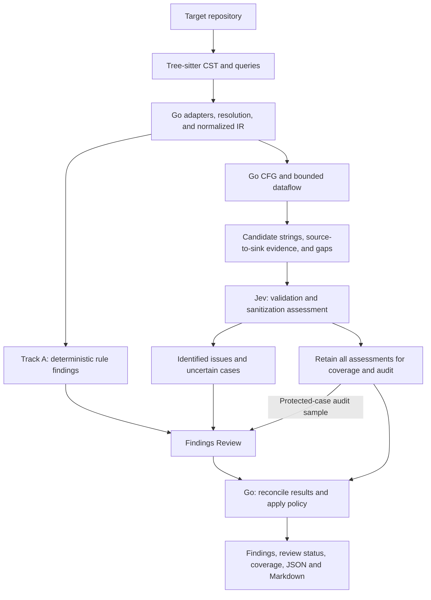
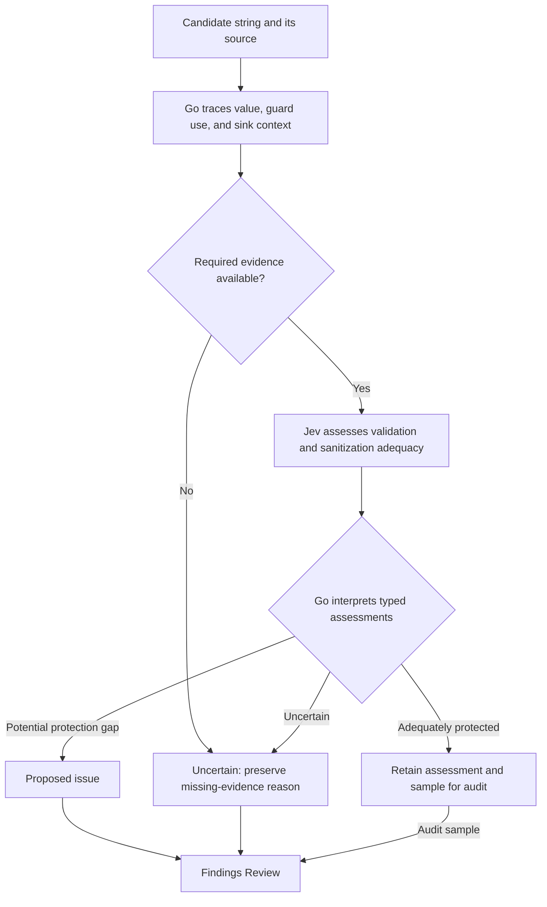
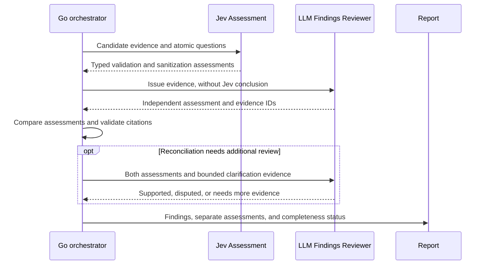

# Architecture

**Architecture direction, 2026-10-19; implementation requires greenlit specs.** This document owns
technical responsibilities and contracts. Product purpose/state lives in [project.md](project.md),
rationale and decisions in the [proposal](project/03-jev-design-proposal.md), and delivery order in the
[implementation plan](project/implementation-plan.md).

## 1. Architecture premise

Tree-sitter extracts syntax. Go establishes supported control and data dependencies. **Jev is the
primary semantic assessor for whether a candidate string is adequately validated or sanitized for
its particular use. The LLM Findings Reviewer reviews identified issues against their evidence.**
Go retains orchestration, reconciliation, reporting, and CI policy.

All scan-authored scanner and code-analysis code is Go: language adapters, graph/flow analysis,
rules, model API clients, orchestration, reporting, and evaluation harnesses. Python and other target
languages describe code being scanned, not implementation runtimes. Tree-sitter's native parser and
grammars remain dependencies with explicit build requirements; this is not a pure-Go dependency claim.
Jev and the LLM are external inference services accessed through Go adapters.

The model split aims to use Jev for fast, lower-cost decisions over candidates and reserve deeper
LLM Findings Review for identified issues, uncertain candidates, and the protected-case audit below.
Measure total pipeline cost and latency, including review volume, retries, and context assembly;
Jev's per-request advantage alone does not establish end-to-end savings.

Experiments measure Jev's accuracy, required context, and failure cases. Findings Review covers all
identified issues in the full pipeline. Provider/model selection, budgets, and calibrated thresholds
remain open.

| Role | Responsibility | Output |
|---|---|---|
| Tree-sitter and Go | Extract code, resolve supported relationships, trace values and guards | Source-backed candidates and analysis gaps |
| Jev Assessment | Assess string validation, sanitization, and relevance to the named sink | Typed assessments and proposed issues |
| LLM Findings Reviewer | Independently inspect the evidence for each identified issue, then compare with the proposed assessment | Supported, disputed, or needs more evidence; evidence references |
| Go policy/reporter | Preserve assessments, apply explicit policy, report findings and review completeness | Auditable report and configured CI result |

Terminology: a **candidate** is a string/use needing assessment; an **identified issue** is a proposed
finding raised by Jev or deterministic rules. **Findings Review** is the stage performed by the
**LLM Findings Reviewer**; reports retain findings together with their assessment and review status.

A call path means potential reachability; a dataflow trace means a supported value dependency under
declared assumptions. Neither a model judgment nor a trace proves runtime execution or exploitability.

## 2. Pipeline

Every identified rule or Jev issue enters Findings Review in the full pipeline. Uncertain candidates
also enter review; a sampled set of Jev's adequately-protected candidates provides a false-negative
audit. This sample measures missed issues in addition to reviewing identified ones. Local-only and
Jev-only runs are useful for diagnostics/experiments, but their reports explicitly mark omitted stages.

Ingestion and parsing use bounded workers. Graph construction has explicit ownership; workers do not
mutate shared graph state without a defined merge strategy. Independent analyses and model requests
may use bounded pools. Stable sorting removes scheduling dependence from deterministic artifacts.

## 3. Parsing and language adapters

The leading parser candidate is [tree-sitter/go-tree-sitter](https://github.com/tree-sitter/go-tree-sitter)
with separately selected grammars. The binding uses native resources that need explicit lifetime
management. A parser spec must decide cgo/build requirements, grammar compatibility, error recovery,
and supported platforms before promising a static binary.

Tree-sitter queries identify syntax such as calls, assignments, branches, route registrations, and
candidate source/sink/validator APIs. A query match is not proof of validation or of data reaching a
sink. A function named `sanitize` is only a candidate guard.

Each language adapter owns grammar selection, query sets, symbol/module resolution, syntax lowering,
and framework/library transfer models. Adding a language includes its control/dataflow semantics,
not merely a grammar and resolver. The shared core consumes normalized operations and declared
capabilities. A new language may expose an IR gap; revisit the contract through a spec rather than
forcing incorrect semantics into an existing operation.

Initial focus is JS/TS: aliases, barrel re-exports, inline handlers, middleware passed by reference,
shadowing, and package boundaries. Python decorators, Go receiver/interface calls, and Java overloads
are design pressure cases; unsupported behavior remains explicit until its adapter lands.

## 4. Normalized representation and graph views

The proposed IR carries modules, callables, basic blocks, statements/operations, value definitions,
uses, and source spans. Security roles are annotations and can overlap; a callable-only node model is
insufficient for assignments and branch guards.

| View | Representative relationships | Meaning |
|---|---|---|
| Module and symbols | `IMPORTS`, `RE_EXPORTS`, `REFERENCES`, `CALLS` | Names and possible invocation targets |
| Type relationships | `INHERITS`, `IMPLEMENTS` | Supported static type relationships |
| Control flow | `NEXT`, `TRUE_BRANCH`, `FALSE_BRANCH`, `RETURN` | Possible ordering within a callable |
| Data dependencies | `DEFINES`, `USES`, `ASSIGNS`, `ARG_TO_PARAM`, `RETURN_TO_CALL` | Supported value transfer |
| Framework/security | route registration, source/sink/guard annotations | Rule/model facts with provenance |

Exact enums and serialized types belong to a future schema spec. Relations carry provenance, source
spans, the resolver/transfer rule used, and unresolved/approximate status. Extracted syntax and inferred
relationships are distinguishable; these labels are not statistical confidence scores.

CFGs and call graphs can contain cycles. They are not assumed to be DAGs. Traversal uses bounded
worklists/summaries and explicitly reports recursion, loop, depth, or candidate limits reached.

Identity separates semantic identity from display locations. Symbols include module/namespace,
receiver and signature discriminators as needed; anonymous callables and multiple sink sites need
stable disambiguation. Line numbers alone are not identities. Rename/move/collision behavior is a
future contract to test, not an assertion that any symbol chain is globally unique.

### Graph storage decision

Use scan-owned typed Go adjacency structures as the canonical in-memory representation. Node/edge
records carry relation kinds and provenance; forward/reverse indexes support relation-filtered
queries. Preserve multiple relations between the same endpoints and self-edges where the IR requires
them. Dense internal indexes may optimize access but are distinct from persistent semantic identities.

Build with explicit ownership, then expose stable read views to analysis workers. Keep per-analysis
worklist/visited/abstract state separate from the shared graph; traversal state may include value and
call context, not only a node ID. Stable ordering is part of the graph contract.

Gonum is not the planned storage dependency. A specific algorithm may later justify a small adapter
over a selected graph view, without duplicating the canonical store. The
[decision rationale](project/03-jev-design-proposal.md#graph-representation-decision) records tradeoffs,
validation work, and conditions for reconsidering this choice.

## 5. Go analysis engine

### Local flow first

The first flow slice covers a declared JS/TS subset: source values, assignments/reassignments,
parameters, expression dependencies, branches, returns, and bounded loop handling. A spec must define
join/merge semantics and conservative handling for unknown operations. Fields, aliases, closures,
exceptions, async behavior, and heap mutation are separate capability decisions, never silently
assumed correct.

### Bounded interprocedural flow second

Resolved argument-to-parameter and return-to-call edges connect local analyses. Function summaries
record input/output dependencies and mitigation facts under declared assumptions. Limits include call
depth, recursion iterations, candidate count, and per-source work. Unknown calls and external packages
produce an explicit gap unless a versioned library model defines their behavior.

No exhaustive path enumeration is required. Summary/worklist analysis can retain representative
witness traces with join points and approximation markers. Cycle handling and termination belong in
acceptance tests.

### Guards and mitigations

A guard mitigates only the specific value/use and sink context it protects. Checking a value after a
sink, ignoring a validator result, validating an unrelated copy, or taking an unchecked branch does
not discharge a candidate. Parameter binding, allow-listing, HTML encoding, path containment, and
shell execution mode are distinct rule-specific facts.

A sanitizer's presence does not terminate taint tracking. Deterministic suppression requires a modeled
transfer/mitigation rule with its preconditions established. Jev can classify a custom check's apparent
adequacy from supplied evidence; it cannot turn an unresolved flow into a proven safe one.

### Protection is specific to a value use

Jev Assessment and Findings Review evaluate the tuple **value → transformations/guards → sink →
control-flow assumptions**. If the protection is correct for that exact use and relevant paths, the
particular vulnerability is prevented; there is no context-independent “safe string” property.
An HTML-text encoder does not establish SQL/path safety, and valid identifier syntax does not establish
resource authorization. See [OWASP validation guidance](https://cheatsheetseries.owasp.org/cheatsheets/Input_Validation_Cheat_Sheet.html)
and [context-specific encoding](https://cheatsheetseries.owasp.org/cheatsheets/Cross_Site_Scripting_Prevention_Cheat_Sheet.html).

The LLM Findings Reviewer is explicitly responsible for challenging a mismatch between protection and
use: wrong encoding context, ignored return, validation of a different value, bypass path, later
transformation, or missing business/framework facts. Successful code-level protection and correct model
recognition of that protection are separate test expectations. The reviewer needs the applicable code;
it cannot close a gap in evidence by agreeing with Jev.

## 6. Detection and candidate selection

**Track A — deterministic rules.** Findings arise from explicit rule conditions over extracted or
supported analysis facts. Determinism describes reproducibility, not certainty that the code is
exploitable. Each rule declares CWE/OWASP edition mapping, severity policy, supported frameworks,
positive/negative examples, and evidence requirements.

**Track B — path classification.** Go produces a bounded source-to-sink candidate with dataflow
witnesses, sink semantics, guards, and gaps. Jev evaluates only the semantic questions not settled by
those facts. Classification is an annotation on the candidate, not its identity.

**Track C — deferred.** Broad controller/authorization/logic review is not carried forward as an
open-ended Jev task. Any future scope check must enumerate its questions, candidate anchors, required
evidence, and evaluation corpus before implementation.

Pruning removes irrelevant graph regions; rule-specific filters handle established mitigation facts.
A non-literal argument is not automatically untrusted, and constants do not by themselves prove all
related operations safe. Unknown or truncated cases are unexamined/uncertain, with reason counts.
Prioritization by rule severity and evidence completeness changes processing order, not proof of safety.

## 7. Evidence bundle contract

A bundle contains a stable candidate ID, rule/version, source and sink spans, ordered witness operations,
call-site bindings, branch/guard facts, relevant validator definitions, library-model/version facts,
and explicit gaps. Source snapshots/hashes bind every span to the analyzed revision.

Per-file, per-snippet, per-bundle, per-run, and request-size budgets are specified before live use.
Incomplete required evidence cannot be silently truncated into a “validated” result. Oversized or
unresolvable candidates are reported as unexamined or uncertain. Repository comments are untrusted
source data, not instructions for the classifier. Payload minimization and redaction policies must
preserve the evidence needed for the question and record any resulting loss.

Go constructs source references and report templates. Jev does not generate explanations or citations.
The LLM Findings Reviewer references supplied evidence IDs; its interpretation is separate from the
underlying source evidence.

## 8. Jev Assessment and Findings Review

### Jev experiment and adapter

Jev receives a candidate string's origin, transformations, named field requirements, validator/helper
bodies, relevant guard results, sink context, and known gaps. The experiment tests separate questions:

- Does the shown validation enforce the named field/type/format constraint?
- What sanitization/encoding transformation is applied, if any?
- Is that transformation appropriate to the named sink and output context?

Validation and sanitization are separate assessments; neither is universally required for every sink.
A parameterized operation, for example, may protect a value without a string-cleaning function.
Go establishes whether the examined/transformed value and required guard outcome reach the actual
sink. Jev does not reconstruct missing control flow or certify a function globally safe.

[TypeSafe's API](https://docs.typesafe.ai/api) accepts state and typed questions at the System One
endpoint. Its Go adapter uses `net/http` and `encoding/json`; see the
[library choices](project/03-jev-design-proposal.md#library-choices). Noul/Choice questions are versioned
and atomic. Independent questions may share a request; dependent questions run in separate stages.
Item batching preserves per-candidate failures and coverage under bounded concurrency. Go validates
answer IDs, types, ranges, and allowed options before applying calibrated policy.

The provisional outcomes `adequately_protected`,
`protection_gap`, and `uncertain` describe candidate protection under stated criteria; the facet
assessments retain the distinction between validation and sanitization. Missing validation alone is
not automatically an exploitable issue. Exact field names/thresholds belong in the future spec.
An answer below a finding threshold is not by itself an adequately-protected verdict. Scores do not
directly set severity; Go applies rule-specific mappings, evidence requirements, and calibrated policy.

### LLM Findings Reviewer contract

For each identified issue, the reviewer examines the same bounded source evidence, relevant helper
bodies and framework facts, then evaluates whether the proposed issue is supported. Its first pass
assesses the evidence without Jev's conclusion to reduce anchoring; Go then compares the independent
result with the Jev/rule assessment. Any follow-up reconciliation call is explicit and bounded.

The review checks the claimed input-to-sink connection, whether validation/sanitization protects the
actual value/use, bypasses and contradictory evidence, and whether required context is missing.
The reviewer cannot create graph facts or assume omitted code is safe. It returns a structured verdict
of `supported`, `disputed`, or `needs_more_evidence`, with evidence IDs and a concise explanation.
Jev and reviewer results remain separate. A dispute is visible; it does not silently delete a finding.

Both adapters have explicit enablement, credentials, pinned models, deadlines, concurrency/request
limits, retry/backoff rules, cancellation, and run budgets. No-key operation marks missing stages
`not_run`; request failures mark them `failed`. A cap or missing credential leaves issues visibly
unreviewed, not accepted or reviewed-safe. An unavailable reviewer does not silently substitute a
Jev-only result for completed Findings Review. Humans retain acceptance and suppression authority.

## 9. Findings, comparison, and CI

The report separates candidate discovery from semantic assessment and CI eligibility:

| Record | Proposed contents |
|---|---|
| Candidate | identity, rule/version, source/sink, witness, guard facts, analysis gaps |
| Assessment | Jev validation/sanitization facets, typed answers, model/question/bundle versions, policy outcome |
| Findings Review | completion status, independent reviewer verdict, evidence IDs, disagreement, model/prompt version |
| Finding | detection track, rule title, CWE/OWASP mapping, severity, evidence, template explanation |
| Coverage | supported/skipped files, parse failures, unresolved edges, limits hit, unexamined candidates |

A deterministic rule does not get a probability of `1.0`; rule certainty and model probability are
separate concepts. Template explanations identify observed facts and predictions separately.

Fingerprints exclude Jev answers, probabilities, model versions, and policy thresholds. A proposed key
uses rule identity plus a scoped sink-site identity; source traces group beneath the finding. The exact
collision/rename/grouping scheme must be specified and tested before persistence. Candidate identity
is separate from whether an assessment currently meets finding/report policy.

A verdict change is an assessment change, not a new structural candidate. It can still require review
or affect policy; stable identity must not silently hide changed risk. Missing/failed/limited analysis
cannot mark a previously observed issue resolved. Comparison requires compatible scan scope and
analysis versions, otherwise status is unknown/unexamined.

Git-tracked baseline entries record reason and ownership; new-finding gating and severity policy are
reviewed separately. Proposed defaults gate selected new Track A findings and keep Track B advisory
until calibrated and explicitly enabled for gating. Exact baseline semantics, incomplete-scan behavior,
and exit codes belong to a future reporting spec. Existing manifest exit codes remain unchanged now.

## 10. Persistence and determinism

Execution uses the [typed adjacency representation](#graph-storage-decision); ordered JSON is an
interchange artifact. Persistence starts with a local cache. Graph databases and Redis are deferred.

Cache Jev Assessment and Findings Review responses separately. Reviewer keys include provider/model,
prompt/schema, exact source evidence, and any supplied prior assessments. Audit-selection or
reconciliation-policy changes can create additional review work.

Cache keys cover content, grammar/binding version, adapter/IR version, resolver configuration,
transitive summaries/library models, rule version, complete evidence bundle, Jev model/question
version, and request options. Raw typed responses are cached separately from policy outcomes, so
threshold changes can be evaluated without inference. Validator summaries cannot be cached as globally
“safe” on a function-body hash alone; value, sink, configuration, and dependency context matter.

Changed imports, callers/callees, guard definitions, models, or configuration invalidate affected
artifacts. Cached and uncached analysis must agree. Exact storage format is deferred to its spec.

Deterministic graph/candidate/rule artifacts are stable for identical input and versions regardless of
worker ordering. Live Jev predictions have no assumed byte-stability guarantee. Request metadata and
operational timing are separate from deterministic artifacts.

## 11. Proposed package boundaries

Only `cmd/scan`, `internal/lang`, and `internal/walk` currently exist. Add packages when approved specs
supply real consumers; this table is a responsibility map, not an instruction to scaffold placeholders.

| Package | Responsibility |
|---|---|
| `cmd/scan` | CLI parsing and wiring |
| `internal/lang` | Existing extension registry; future adapter registration |
| `internal/walk` | Input manifest and selection |
| `internal/parse` | CST/query lifecycle and parser workers |
| `internal/ir` | Normalized analysis operations and source provenance |
| `internal/graph` | Graph views and adjacency indexes |
| `internal/rules`, `internal/patterns` | Classification models and deterministic findings |
| `internal/flow` | CFG/dataflow transfers and function summaries |
| `internal/trace` | Bounded witnesses, pruning, deduplication |
| `internal/context` | Evidence bundle assembly and completeness |
| `internal/jev` | Typed System One transport and validation |
| `internal/llm` | LLM Findings Reviewer adapter; independent assessment and bounded reconciliation |
| `internal/policy` | Jev interpretation, review reconciliation/completeness, audit selection, gating |
| `internal/findings`, `internal/report` | Identity/baseline/comparison and report emission |

Language-specific lowering and resolution sit behind adapters; their concrete directory layout is
chosen in the parser/IR spec. Shared analysis does not depend on Tree-sitter node types or HTTP.
The CLI uses standard-library `flag`, `encoding/json`, and normal exit-code handling; no CLI framework
is planned. A future change needs a concrete requirement the existing surface cannot reasonably meet.

## 12. Validation and unresolved decisions

Golden fixtures cover extraction/resolution. Hand-built flow fixtures cover assignments, branch joins,
cycles, guard bypass, ignored results, argument/return propagation, and unknown calls. Determinism tests
compare serial/parallel output; cache tests compare cold/warm results and dependency invalidation.
Local HTTP stubs cover semantic adapters, schema validation, retries, cancellation, and partial failures.
Live evaluation is separate, opt-in, versioned, and compared with human-labeled held-out examples,
including diagnostic Jev-only/LLM-only baselines and the planned Jev Assessment → Findings Review pipeline.
Measure reviewer disagreement, incorrect agreement, unsupported citations, review completeness, and
false-negative audit results against human labels; LLM agreement is not ground truth. See the
[research/evaluation note](project/04-jev-validation-research.md).

The [proposal decision register](project/03-jev-design-proposal.md#open-decision-register) owns unresolved
choices and their refinement gates; [scope](project/02-project-scope.md) owns project-level risks and
quality hypotheses.
