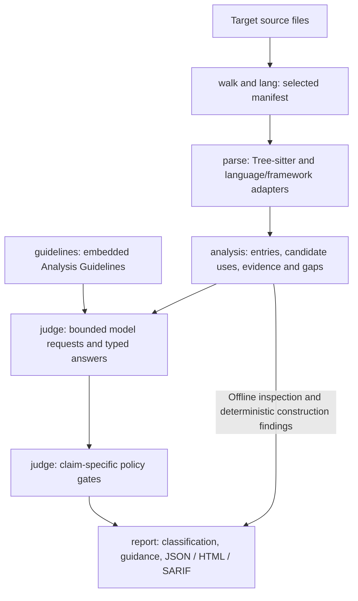

# Architecture

**Implemented architecture, updated 2026-11-05.** This document owns package responsibilities,
terminology and pipeline boundaries. Planned components are labeled explicitly. Product direction
lives in [project.md](project.md), decisions in the [proposal](project/03-jev-design-proposal.md),
and delivery order in the [implementation plan](project/implementation-plan.md).

## Current provider decision

Zazzles uses a provider-neutral **semantic judge** to analyze source-backed security claims.
The Go client supports explicit `openai` and `jev` transports. Development and live calibration
use OpenAI Decisions with `gpt-6-luna`; transport support does not establish equivalent provider
accuracy. Credentials do not select a provider or authorize a paid request. No provider/model
fallback occurs. See [decision-model setup](../docs/decision-models.md).

Decision-model judgment is core to a completed security assessment. Offline inventory, evidence
inspection, deterministic construction findings and saved-report export remain available.
A run without `--judge` leaves model assessments `not_run`; it does not complete a model-assessed
scan. A request cap or transport failure remains visible.

**Independent Findings Review is planned.** It is a separate evidence review by an LLM reviewer,
not another name for the implemented semantic judge or the report's Review category.
There is no implemented reviewer stage or reviewer-completion field in current reports.

## Design rationale and strengths

The [technical approach](../docs/technical-approach.md) explains the combination of bounded static
evidence, semantic judgment, separate claims, explicit blockers and preservation/repair guidance.
It compares documented SAST capabilities, distinguishes product differentiation from established
prior art and links measured case evidence and known misses. Better recall, precision, cost and
novel-repository generalization remain hypotheses until matched independent evaluation.

## Detailed analysis designs

- [Repository graph](architecture/repository-graph.md): target-repository graph direction and bounded implemented subsets.
- [Evidence and claims](architecture/evidence-and-claims.md): source slices, requirements and completeness.
- [Trace judgment](architecture/trace-judgment.md): implemented evidence bundles, gates and exact-request replay.
- [Reporting and SARIF](architecture/reporting-and-sarif.md): report records and implemented bounded SARIF export.
- [Standalone HTML](architecture/html-reporting.md): human-facing report and disclosure rows.
- [SCA follow-on](architecture/sca-design.md): planned dependency auditing.
- [Analysis components](architecture/analysis-packs.md): SQL component ownership, selection, bounds,
  provenance, compatibility and incremental migration ledger; [original proposal](project/analysis-pack-mvp.md).

## Product boundaries and shared engine

The [project goals](project.md#four-product-capabilities) distinguish Scan, Inspect, Audit and Fix.
The architecture below describes the current bounded Scan engine. It also emits existing validation
and construction-practice findings. Inspect as a distinct capability, dependency Audit and automated
Fix are planned. The goals do not imply separate implemented commands or engines.

Scan and future Inspect can share static models, source evidence, semantic judgment and completeness
policy while retaining claim-specific requirements. Audit retains independent dependency/advisory
provenance. Fix will consume supported issues from all assessment domains and verify repairs.
The intended capabilities run independently in any order, with their own inputs and verification.
An agent loop is an optional composition, and Fix may start from an existing report or a supplied
issue without fresh runs of every assessment. Future quality presentation and domain-specific policy
require their own contracts. Review remains
an unresolved-evidence outcome, not the quality capability.

## 1. Architecture premise

Tree-sitter extracts syntax. Go adapters resolve supported bindings and establish bounded value/control
relationships. The semantic judge evaluates named claims using that evidence and the embedded
Analysis Guidelines. Go policy prevents model answers from overriding missing source facts or blockers.
The reporter preserves evidence and answers while producing Findings, Review and Protected records.

The scanner and its language adapters are implemented in Go. Tree-sitter grammars and bindings
require cgo and a C compiler. Python is a target language, not a separate scanner runtime.
Repository maintenance and evaluation utilities also include Python scripts; they are outside the
scanner binary. Analyzed applications are read as source, never executed by the analysis pipeline.

| Term | Meaning |
|---|---|
| Analysis Guidelines | Versioned language documents with secure coding guidance and evidence interpretation instructions |
| Application requirement | A concrete field or behavior constraint supplied by source or an explicit scan check |
| API model | A versioned library contract, applicable only with verified binding/provenance |
| Entry | A logical analysis starting point; represented by common typed entries, registrations, dispatch and invocation records |
| Candidate use | A value-consuming security operation requiring claim-specific analysis |
| Claim | A particular question about injection, validation, rendering or logging |
| Evidence | Source text, span and snapshot hash supporting an observed fact |
| Dependency / trace | Supported static value relationships under declared conditions, not runtime execution |
| Gap | A fact the bounded analysis could not establish |
| Blocker | A gap relevant to the named claim that prevents a definitive conclusion |
| Assessment | Raw model answers, completion metadata and policy interpretation |
| Finding record | A presentation record; it can describe a defect, unresolved analysis or protection |
| Review | The current report category for unresolved evidence; no independent reviewer is implied |
| Findings Review | A planned independent review stage for identified issues and selected controls |

**Poor practice** remains a finding classification for established construction or enforcement defects.
It is distinct from the former document/type name `Practice`; the classification is not renamed.
No trace or model judgment proves runtime execution or exploitability.

## 2. Pipeline

`cmd/scan` wires these stages. The current request loop is sequential, explicitly capped and
prioritizes SQL/NoSQL candidates. Failed or capped requests remain failed/unassessed; no retry or
provider fallback is automatic. Source evidence and candidate ordering are deterministic for identical
inputs; live model predictions have no assumed byte-stability guarantee.

There is no general repository IR builder, independent reviewer, persistent cache or severity CI gate
in this pipeline. Bounded worker pools and richer graph indexes are future architecture choices.

## 3. Parsing and language adapters

`internal/parse` owns Tree-sitter lifetimes, module resolution, framework bindings, bounded flow,
security operation models and evidence assembly. Its name reflects its origin; it currently owns
more than syntax parsing. Shared records do not depend on Tree-sitter nodes or HTTP clients.

- JS/TS analysis covers supported Express/CommonJS/ESM routes, helpers, browser entries,
  database/logging/outbound operations, templates and selected stored/cross-tier XSS relationships.
- Python uses `python_*.go` files for local modules, Flask/Blueprint, RESTX and FastAPI routes,
  value/control flow, DB-API, validation, logging, HTTP and template semantics. Supported inline
  template scripts reuse browser analysis. See [Python coverage](../docs/python-support.md).
- `Analyze` discovers supported registration files across languages when `--entry` is omitted;
  `AnalyzeWithChecks` additionally accepts explicitly declared security requirements.
- File-extension recognition in `internal/lang` does not imply an implemented language analyzer.

An API name alone is not proof of binding, source control or protection. Unknown calls, dynamic
registration, helper limits and unsupported control/heap behavior retain explicit uncertainty.
Adapter-specific limits and current case evidence belong in their contracts and coverage guides.

### Multiple entry and dispatch mechanisms

**Architecture decision:** analysis roots MUST be independent of HTTP routes. Entry kinds and dispatch
mechanisms are separate dimensions; language is another. An entry does not, by itself, establish an
untrusted source. Input origins and trust assumptions remain explicit evidence.

The shared design separates these concepts:

| Concept | Responsibility |
|---|---|
| Entry point | A logical analysis root with identity, kind, location and input/context roles |
| Registration | Source/configuration evidence exposing or wiring an entry, including generated registrations |
| Dispatch binding | A supported relationship from an entry/registration to possible callables, with conditions, order, provenance and unresolved alternatives |
| Callable | The function/method implementation, independent of the number or kind of registrations invoking it |
| Invocation context | Actual parameter/receiver/closure bindings and applicable controls for a particular dispatch path |
| Transport | Optional delivery context, such as an HTTP endpoint carrying GraphQL operations |

Implemented consumers include JS/TS HTTP, Python HTTP, browser script/component and explicit
DOM/window events, finite dynamic HTTP registration, bounded Apollo GraphQL resolvers and Node.js
unary gRPC handlers. Entry kinds remain independent of language and transport. Shared callable bodies
never supply a sibling invocation's controls. Message queues, CLI commands and scheduled jobs remain
outside this milestone.

`AnalysisReport` owns canonical entry/registration/dispatch/callable/context collections; candidates
and findings refer to `entry_id` and `invocation_context_id`. Method/path/mount data belongs only to
HTTP metadata. `RouteInventory` remains a separate schema1 HTTP view. Kind-specific selectors and
presenters use the same identities; saved schemas1/2 convert privately at the input boundary without
inventing missing invocation facts or changing historical answers.

Browser event input, GraphQL args/parent/context/info and gRPC request/metadata/callback roles remain
separate. Literal SDL/proto declarations establish supported registration/input bindings, not business
policy or sink protection. Unknown runtime composition, dispatch, applicable guards and reached limits
remain explicit gaps, including entries with no candidate. Transport relationships are metadata and
do not multiply resolver uses. No entry-wide safety label or runtime execution claim is produced.

The [implemented subsets and limits](../docs/running-scans.md#common-entry-selection-and-tagged-checks)
and [design](architecture/common-entry-dispatch.md) own the bounded contracts. The
[acceptance results](evaluation/common-entry-dispatch-results.md#cross-entry-acceptance-2026-11-05)
record actual adapter-to-claim/report checks and unchanged HTTP/browser evidence. Automated acceptance and bounded localhost rendered interaction/narrow-layout review pass. The
[SQL/NoSQL closeout](evaluation/common-entry-dispatch-results.md#sqlnosql-only-accuracy-refresh-and-rendered-review)
records the later accuracy refresh and remaining calibration limits; human review/merge is pending. Broader GraphQL/gRPC application evaluation and a
full repository IR remain separate work.

## 4. Normalized representation and graph views

`internal/analysis` is the shared record model. It contains `RouteInventory`, `AnalysisReport`,
`CandidateUse`, `Evidence`, `Dependency`, `Completeness`, `Assessment` and presentation records.

Three structures MUST remain distinct:

- **Route inventory:** `RouteInventory` lists syntactic route registrations and handler/call steps.
  Its schema-1 JSON is not a whole-program control/dataflow graph.
- **Evidence trace graph:** `internal/judge` projects supplied dependencies/control edges into a
  request-local graph with evidence references, operand roles and a coverage ledger. It discovers
  no additional calls from surrounding text.
- **Repository graph:** the broader [repository graph design](architecture/repository-graph.md)
  describes planned canonical modules, operations, control flow and adjacency indexes. The complete
  generalized IR and indexes are not implemented by the current record package.

Route IDs include source offsets. They identify the analyzed snapshot and are not edit-stable issue
fingerprints. Candidate identities remain independent of model answers and report classifications.

### Graph storage decision

**Planned:** use owned typed Go adjacency structures for the generalized repository graph; preserve
relation kinds, provenance, parallel relations and self-edges. Traversal state remains separate from
shared records. CFG/call graphs can contain cycles and require bounded worklists and explicit limits.
Gonum is not a storage dependency. See the [decision rationale](project/03-jev-design-proposal.md#graph-representation-decision).

## 5. Go analysis engine

### Local flow first

Language adapters follow their supported assignments, projections, alternatives, guards and operation
operands. Unsupported loops, aliases, exception paths and dispatch remain gaps according to the adapter.
Source availability does not establish complete control flow or runtime feasibility.

### Bounded interprocedural flow second

Resolved helper arguments/parameters and returns carry dependency witnesses and source provenance.
Unknown bindings, recursion and reached expansion bounds cannot establish protection. General reusable
function summaries and whole-program heap/control analysis remain planned.

### Guards and mitigations

A guard applies only to the actual value, constraint, ordering and use it protects. Checking a sibling
field, ignoring a result or checking after the sink does not discharge the claim. API contracts require
verified import/constructor evidence. A sanitizer name alone does not terminate tracking.

### Protection is specific to a value use

Validation, query binding, HTML encoding, sanitization and sensitive-content classification are separate
questions. A bound SQL value can be protected against syntax injection while failing an established
email-format requirement. An escaped branch cannot lend protection to an unresolved sibling.
Protection requires every relevant modeled path; one supported unsafe path can establish a defect
under its stated conditions. Missing requirements remain uncertain rather than invented.

## 6. Detection and candidate selection

Deterministic Go logic recognizes supported operations and construction defects. The semantic judge
answers claim-specific questions about the supplied evidence. `internal/guidelines` holds Markdown
Analysis Guidelines, not an executable pattern/rule engine. Current poor-practice findings and model
verdicts are reconciled by Go judgment/reporting code, not by a separate rules-engine package.

Guidelines combine secure coding recommendations with instructions about evidence and uncertainty.
They are embedded with `go:embed` and selected by language. Report metadata retains their ID/version;
unmigrated-family model inputs include the full applicable document. SQL selects applicable sections
through the component catalog and records their digests. The Go document is preparatory guidance and does
not imply implemented Go source analysis. Root [analysis guides](../docs/analysis/README.md) describe
product behavior; `.zazz/standards/` governs development. Neither is loaded dynamically by the binary.

## 7. Evidence bundle contract

The [trace judgment design](architecture/trace-judgment.md) owns evidence-version 3: deduplicated
source evidence, dependency witnesses, trace/control edges, roles, required evidence, API contracts,
exact field constraints and remaining blockers. Supplied evidence means present, not complete or
protective. Source/comments are untrusted data, never model instructions.

Model envelopes use `analysis_guidelines`. The generic question protocol is `candidate-use-v10`;
SQL uses `sql-components-v2`, NoSQL `nosql-components-v1`, standalone validation
`validation-components-v1`; XSS/logging/outbound retain their existing protocols. Renamed guideline
documents carry new versions because their request text changed. Request identity includes the full
envelope and guideline body; old responses cannot be replayed on renamed/changed requests.

## 8. Decision Assessment and Findings Review

### Decision experiment and adapter

**Implemented:** the judge supplies named choice questions for validation, construction/protection,
injection, XSS and logging as applicable. It validates responses, completion state and answer details,
then applies claim-specific completeness and consistency gates. Model confidence cannot fill blockers.
Raw answers are retained separately from the final finding status.

### Provider-neutral judge boundary

`internal/judge.Client` supports explicit OpenAI/TypeSafe transport selection using `net/http` and
`encoding/json`; no speculative provider interface is required. Provider keys stay out of evidence
and saved traces. Requests are bounded to 64 KiB and responses to 1 MiB, with deadlines and no automatic
retry/fallback. Local HTTP stubs test both transports; live calibration is separate evidence.

### LLM Findings Reviewer contract

**Planned:** independent evidence review returns supported, disputed or needs-more-evidence outcomes.
The proposed first pass excludes the judge's conclusion to reduce anchoring, followed by bounded
comparison/reconciliation. Review of identified issues, uncertain cases and protected controls needs
its own schema, budget, model choice and evaluation contract. Current reports MUST NOT imply that
this stage ran. Its absence does not mean a Review-category record has received independent review.

## 9. Findings, comparison, and CI

`report.Enrich` derives presentation records from candidate uses and assessments. JSON retains raw
evidence/answers; HTML supports human review; SARIF supplies standard security-tool interchange.
Only final `protected_for_claim` records may use green protection styling. Review records name missing
evidence and findings name the supported defect; guidance is not a verified applied fix.

Finding records currently group multiple concerns within a use. Fully independent claim-level
counting, edit-stable fingerprints, baseline comparison and severity CI gates remain planned.
Exit 0 means execution completed, not that the target is secure. Exit 1 signals execution or requested
assessment failure; exit 2 signals invalid usage.

## 10. Persistence and determinism

**Implemented:** saved JSON reports and explicit decision traces. Preview/replay compares compact JSON
bytes, model/provider request content and question version. Changed evidence, guidelines, roles or
instructions cannot inherit an old answer. Reading a historical report is distinct from replaying a
decision onto newly generated evidence. Historical sample artifacts retain original versions/answers.

**Planned:** automatic persistent source/summary/decision caches, independent reviewer caches and
incremental invalidation. There is no automatic runtime cache implied by saved evaluation replays.

## 11. Implemented package boundaries

| Package | Current responsibility |
|---|---|
| `cmd/scan` | CLI arguments, pipeline wiring, request caps and export modes |
| `internal/walk` | Target file selection and manifest |
| `internal/lang` | File-extension language registry |
| `internal/parse` | Tree-sitter, language/framework resolution, bounded flow and evidence assembly |
| `internal/analysis` | Shared route, candidate, evidence, claim, assessment and report records |
| `internal/guidelines` | Embedded versioned language Analysis Guidelines |
| `internal/analysispacks` | Embedded family component catalog, deterministic selection and bounded material |
| `internal/judge` | Evidence requests, provider transports, typed answers, policy gates and explicit replay |
| `internal/report` | Presentation classification, guidance and JSON/HTML/SARIF bundles |

The diagram names responsibilities, not additional packages to scaffold. Future `ir`, `flow`, `trace`,
`context`, `policy`, `findings` or reviewer packages require real consumers and an approved contract.
Today flow/evidence construction lives in `parse`, claim gates in `judge`, and presentation rules in
`report`. Shared records import neither Tree-sitter nor provider transport.

### Naming and compatibility

`--analyze` is the documented analysis mode; `--strings` remains an external compatibility alias.
Internal APIs use `Analyze`, `AnalyzeWithChecks`, `CandidateUse` and `AnalysisReport`, with no obsolete
Go aliases. Fresh analysis reports use schema4, `analysis_guidelines` and SQL component provenance; route inventory stays
schema1. Export reads schemas1/2/3/4 and preserves original schema provenance and raw
assessments. Private legacy decoding maps `practice` metadata to `GuidelinesRef` and
legacy route/client associations into one current entry/context association.
New serialization emits only `analysis_guidelines`. Raw historical candidate IDs and status meanings are preserved; fresh candidate IDs
include snapshot/context/value witnesses and are not edit-stable finding fingerprints. Historical command transcripts and source-containing sample artifacts are not rewritten.

## 12. Validation and unresolved decisions

Golden fixtures verify parsing, source spans and deterministic evidence. Paired controls exercise
raw/protected/unknown paths and existing languages. Local HTTP stubs verify both transports, malformed
answers, cancellation, payload limits, policy gates and replay identity. CLI tests cover analysis,
compatibility flags, schema-1/schema-2 exports and mixed-language bundles. Native Go test/race, vet,
build and formatting checks follow the [contributor guide](../docs/contributing.md).

Live sample calibration and source-reviewed case checks do not establish whole-program recall,
runtime exploitation, provider parity or independent findings review. See the [Python results](evaluation/python-support-results.md)
and [XSS results](evaluation/xss-implementation-results.md) for measured coverage and remaining gaps.
The [proposal decision register](project/03-jev-design-proposal.md#open-decision-register) owns open design
choices; the [scope](project/02-project-scope.md) owns project-level risks.

## CLI report artifacts

The [reporting design](architecture/reporting-and-sarif.md) owns canonical JSON/SARIF; the
[HTML design](architecture/html-reporting.md) owns the human-facing report. Current scan bundles contain
`findings.json`, `findings.html` and `findings.sarif`. Saved reports can be exported without rescanning
or model calls; comparator results remain separate evaluation artifacts.
