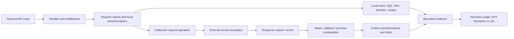

# Target repository graph design

**Design direction, 2026-10-31.** This document owns the graph structure for analyzing a **target
repository**: the application source under analysis, distinct from scan's own repository. It is a
proposed semantic design; the current route-v1 artifact is only a syntax inventory. The
[architecture](../architecture.md) owns pipeline/provider contracts and the
[implementation contract](../specifications/route-string-validation.md) declares the implemented subset.

## Objective and analysis boundary

Start at inbound API endpoints/routes. Follow supported internal control and value dependencies,
including strings sent in outbound service calls, values received in responses, and their subsequent
uses. Prepare evidence for a semantic judge (GPT Decisions, Jev, or another explicit provider) to assess
sufficient validation/protection and potential source-code vulnerabilities. Expand toward selected
OWASP Top 10 families through separately evaluated capability slices.

A call graph shows possible calls; it does not establish that a particular string reaches a sink.
Tree-sitter supplies syntax. Go resolves names and constructs supported control/dataflow facts. The
judge interprets context-specific protection from evidence. Model judgments MUST NOT create graph
edges or discharge missing flow evidence. Unsupported behavior remains an explicit gap.

The remote boundary records a possible exchange, not the service's implementation or observed
network traffic. Scanner analysis MUST NOT execute outbound requests found in target source. If the
remote repository is separately analyzed later, connect snapshots using an explicit API contract;
matching URL strings alone does not establish cross-service value flow.

## Canonical records and views

Use scan-owned typed Go records with relation-filtered forward/reverse adjacency indexes. Preserve
parallel relation kinds and self-edges. There is one canonical store; call, control, data, and security
views project from it. No graph database is required. Immutable read views follow graph construction;
analysis worklists and context state stay separate. No file is parsed repeatedly for each route.

| Record kind | Responsibility |
|---|---|
| Snapshot / module | Target scope, relative path, source hash, language and parser versions |
| Symbol / callable | Lexical binding, imports/exports, signature, parameters, body and returns |
| Route registration / entry point | Method/path syntax, receiver provenance, ordered middleware, mount context, handler binding |
| Basic block / operation | Ordering, branches, assignments, calls, returns, throws, await and supported transfers |
| Value definition | Parameter, literal, field projection, expression result or merged definitions; distinguish reassignments |
| External service / exchange | Known or dynamic destination, request operation, response/error results, library model |
| Security annotation | Source, sink, candidate guard or transformation with model/version and preconditions |
| Gap | Affected record/span, reason, capability/limit, and impact on completeness |

Annotations can overlap. An outbound HTTP operation can use an untrusted destination (an SSRF
candidate), transmit sensitive string fields, and introduce untrusted response values. A callable named
`sanitize` is a candidate helper, not a globally safe value. Gaps are records, not invented callee nodes.

The following names describe semantics, not finalized Go enums or a released JSON schema:

| Relation and direction | Meaning / required justification |
|---|---|
| module → symbol `DECLARES`; binding → target `REFERS_TO` | Exact lexical/import resolution or explicit set of possible targets |
| registration → callable `HANDLED_BY` | Framework registration plus callable/factory resolution |
| registration → middleware `USES_MIDDLEWARE` | Ordered registration/mount applicability; pathless middleware is represented |
| caller operation → callable `CALLS` | Supported target binding; separate call site and function identity |
| block → block `NEXT`, `TRUE_BRANCH`, `FALSE_BRANCH`, `EXCEPTION` | Possible control successor with associated condition/exception |
| operation → value `DEFINES`; value → operation `USED_BY` | Expression result or actual operand position |
| value → value `TRANSFERS_TO` | Supported assignment, projection, concatenation or transformation with operation provenance |
| argument value → parameter value `ARG_TO_PARAM` | Callee binding, argument index and call context |
| return value → call-result value `RETURN_TO_CALL` | Return site and matching call context |
| value → outbound operation `REQUEST_ARGUMENT` | URL/path/query/header/body role and encoding/serialization location |
| outbound operation → service boundary `REQUESTS` | Literal/dynamic destination evidence and versioned client model |
| service exchange → response value `RESPONSE_VALUE` | Opaque remote body/status/header/error source; no invented dependence on request strings |
| result → continuation `RESUMES` | Modeled await/then/callback binding, success/error branch and call-site correlation |

Control order is not value dependence. Structural relation certainty (`observed`, `resolved`,
`approximate`, `unresolved`) is separate from a model probability. Every inferred edge MUST identify
its resolver/transfer rule and source evidence. Exact unresolved/approximation rules belong to the
language subset's implementation contract.

## Source locations, identity, and provenance

Every source-backed record carries a repository-relative slash path, snapshot content hash,
half-open byte span and 1-based line span. Derived records cite their input records and rule versions.
Source snippets come from that snapshot; a re-read changed file cannot substantiate stale byte offsets.

Dense in-memory IDs can accelerate indexing. Persistent identities are separately namespaced by
artifact kind and schema. Symbol identities include module/lexical scope and signature discriminators;
anonymous functions and multiple sink sites require disambiguation. Route-v1 byte-offset IDs are
snapshot locations, not edit-stable findings. Finding identity and move/collision policy are a later
contract; model answers MUST NOT be part of structural identity.

Deterministic records sort by stable keys. Artifact versions include grammar, adapter, IR, resolver,
library/security models, scope and source hashes. Model assessments remain separate records keyed
by evidence hash, provider/model, question/version and policy; changing providers does not rewrite
the graph or assert equivalent calibration.

## Value flow, guards, and taint

Taint describes dependency on a specified source under declared assumptions. It is not the same as
“every nonliteral string is malicious.” The graph MUST preserve the original source, transformed
values, assignments/reassignments, actual sink operands, joins and gaps. Heap/field aliases, closures,
exceptions, promises and dynamic dispatch are modeled only where their capability is implemented.

Validation and sanitization adequacy are semantic questions about a **specific value/use**. Go supplies
the condition checked, success/failure branches, dominance/bypass evidence, helper body and actual
value consumed. The judge assesses the check against the sink's requirements. Code facts and
predictions remain separate. Desired evidence: a checked value reaches its sink only on the required
branch. Rejected inference: Juice Shop's length limit in `routes/search.ts` alone establishes SQL
protection (see [source assessment](../project/06-route-validation-assessment.md#suggested-first-security-slice)).

Parameterized SQL, output encoding, allow-lists and path containment have different preconditions.
A model can recognize a custom validator without scan hard-coding its regex, but the analyzer must
still establish that its result controls the relevant use. Unknown transfers may preserve possible
taint conservatively; they MUST NOT manufacture a proven source-to-sink witness or safe outcome.

## Outbound requests and return flow

Represent call-site-specific request slots: destination/URL, path segments, query, headers and body.
Track string construction and serialization separately from the transport operation. A URL validator
is assessed against the destination use; validation of one body field does not protect another.
Connection libraries, wrapper helpers, redirects and error behavior require versioned models.

An external response introduces a separate source with field projections and success/error outcomes.
For `const response = await fetch(url); const text = await response.text(); render(text)`, model
URL → request, exchange → response, response decoding → text, and text → render operand as separate
relationships. Do not infer that response text equals the sent URL. Support for request initiation
alone does not imply support for response parsing or asynchronous continuation.

RPC/SDK clients follow the same boundary concept with method/argument slots. Unknown clients,
computed destinations, dynamically dispatched callbacks and unmodeled response parsers produce gaps.
Declared limits make it clear when traversal cannot proceed after the service call.

## Field-validation and persistence cases

A sensitive use can be ORM-backed account creation rather than an injection sink. Generated routes,
ordered middleware/next()/return edges, model constraints, setters and hooks are required graph facts
for those cases. Keep field/type/nonempty/normalization requirements separate from SQL parameter
binding. See the [registration case](../project/07-registration-validation-case.md) for the concrete
acceptance slice, including why challenge observers are not validators or persistence evidence.

Completeness is scoped to the claim and witness. A supported violating path can establish a potential
issue even when unrelated graph regions remain incomplete. Conversely, an unknown protective
middleware or model constraint on that path can block the finding. Checked mode now represents and tests these claim-specific dependencies; legacy candidates
remain conservative. Do not substitute unconditional trust in model outputs for missing facts.

## Candidate evidence and traversal

A candidate is anchored to a use/sink and its relevant source definitions, not just a function chain.
An evidence bundle includes route/receiver/handler bindings, source/sink argument roles, ordered
transfer witnesses, branch conditions, validator bodies, outbound exchange context if relevant,
library models, snapshot-bound source snippets and all relevant gaps. Candidate discovery, protection
assessment and independent Findings Review have separate completion states.

Traverse with bounded worklists and function summaries. CFG/call graphs can contain cycles; do not
enumerate all execution paths. Context includes value definitions and matching calls/returns, not
merely visited node IDs. Call depth, recursive iterations, loop convergence, candidate count, source
size, payload and total work have declared limits. A bound reached is reported as incomplete.

## Delivery mapping and validation

| Phase | Graph contribution |
|---|---|
| 2 | Snapshot-backed syntax, normalized operations/values and graph schema |
| 3 | Receiver/import/call resolution; source, sink, external-client and library models |
| 5 | Local CFG/value flow and actual guard-use facts |
| 6 | Bounded argument/return flow and explicitly supported asynchronous continuations |
| 7 | Minimal reconstructable source-to-use evidence with completeness markers |
| 8 | Provider-neutral judgment and separate review; no graph mutation by the model |

The [near-term plan](../project/implementation-plan.md#structural-analysis-and-semantic-judgment)
selects a thin vertical slice across these phases. Tests need safe/vulnerable/unknown pairs, HTTP-client
route negatives, shadowing, reassignment, ignored guard results, bypass, mismatched calls/returns,
cycles/limits and request/response separation. Every graph edge must survive source inspection.
Evaluate graph/candidate recall separately from judge accuracy; a missed candidate never reaches the judge.
