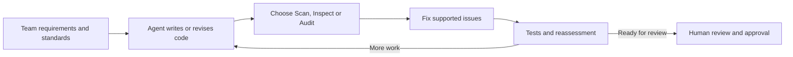
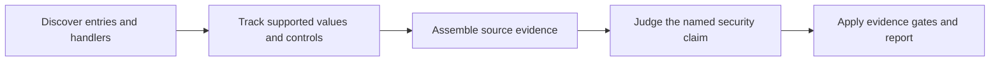

# Zazzles

Zazzles helps developers and coding agents assess application security, code quality and dependencies,
then use the resulting evidence to make verified repairs. It explains what needs attention, what
already works, and what remains uncertain.

Security findings and quality assessments have distinct purposes. For example, an application can
safely bind a value into SQL while failing to enforce a required input format. The validation defect
still deserves a fix, but it does not establish an injection vulnerability.

The broader goal is a feedback loop: agents create code, Zazzles assesses supported requirements,
and agents repair issues before tests and reassessment. Teams should be able to use their own
coding and architecture standards without adopting Zazz methodology.

**Available today:** bounded Scan analysis for JavaScript, TypeScript and Python, including
input-validation judgments and selected construction-practice checks. **Planned:** a distinct Inspect
capability, dependency Audit and automated Fix. Supported checks and limits are described below.

<a id="project-goals-scan-audit-and-fix"></a>
<a id="project-goals-scan-quality-audit-and-fix"></a>

## Project goals: Scan, Inspect, Audit and Fix

| Capability | Primary purpose | Status |
|---|---|---|
| **Scan** | Identify security vulnerabilities and assess security controls | Implemented subsets in JavaScript, TypeScript and Python |
| **Inspect** | Assess code quality, maintainability and conformance to coding and architecture standards | Planned capability. Existing validation and construction-practice checks provide a foundation |
| **Audit** | Identify vulnerable dependencies and retain advisory evidence | Planned |
| **Fix** | Help agents repair supported issues from Scan, Inspect and Audit, then verify changes | Planned |

Today's CLI and sample reports describe Scan, which also reports supported validation and
construction-practice concerns. There is no separate Inspect command or report view yet.
The four goals define product responsibilities, not four implemented CLI commands.

**Run independently, in any order.** The intended capabilities are not a required pipeline. Use Scan
for security, Inspect for code quality, or Audit for dependencies as needed.

Fix can start from an existing report or a user-specified issue without requiring a fresh run of
the other capabilities. Each still needs its own inputs and verification.

Inspect will keep standards assessments distinct from security findings while reusing analysis
components and source evidence. Review remains the report outcome for unresolved evidence, not
another name for Inspect. Linked security and quality claims should avoid duplicate issue counts.

Security risks should be easy to prioritize without burying them in routine quality observations.
Priority still depends on impact. A serious correctness defect can also require urgent attention.

Audit will use ecosystem tools such as `npm audit` and `pip-audit`, with consistent reporting and
software bill of materials (SBOM) artifacts. An SBOM lists an application's components.
See the [dependency-audit design](.zazz/architecture/sca-design.md).

Fix will use evidence from all three assessment capabilities. It should preserve intended behavior
and existing protection while producing reviewable repairs. The [remediation philosophy](docs/philosophy.md)
explains that goal. Inspect, Audit and automated Fix remain planned.

## Goal: an assessment and remediation loop for agents

**One possible planned workflow:** a coding agent writes or revises code, selects Scan, Inspect
or Audit assessments as needed, then uses Fix to address supported issues. Tests and reassessment
check the revision before review. This loop is optional, not a required order for the capabilities.



Teams should be able to select their own standards for code structure, architecture, validation
and other engineering practices. Using Zazzles should not require adopting Zazz methodology.
The selected standard supplies the requirement. Source evidence shows whether the implementation
meets it within the supported scope.

Users should not need to write a standards manual to get started. Zazzles already supplies
versioned language guidance for security assessment. Broader quality baselines and optional team
profiles are planned. Findings about standards need an identifiable requirement and source evidence,
not only a model's preference.

The SQL, NoSQL, standalone-validation and XSS [analysis components](docs/technical-approach.md#analysis-knowledge-and-components)
organize existing knowledge with explicit versions and applicability. Broader team-standard
components remain planned under the [standards-workflow design](.zazz/project/analysis-pack-mvp.md#standards-driven-agent-workflow).
Deterministic checks can handle mechanical requirements. Semantic judgment can assess contextual
requirements using the actual implementation and relevant relationships.

**Available today:** bounded assessments and reviewable reports. **Planned:** general standards
selection and assessment, plus automated repair orchestration. Zazzles does not currently load
arbitrary standards documents or run this entire loop.

Passing an assessment covers only its named requirements and analyzed scope. Tests and human
review still matter. Unsupported standards, missing context and unresolved questions remain visible
instead of becoming a claim that all code meets a team's standards.

## Scan: current implementation

Scan reads application source and follows supported input values into security-sensitive operations,
such as database queries or HTML output. It records the relevant code, value transfers, controls
and analysis gaps. It does not execute the application.

A decision model assesses specific security questions using that evidence. Go policy then checks
whether the evidence and answers support the conclusion. Missing facts remain explicit, even when
the model gives a confident answer.

Development and calibration use the OpenAI Luna Decision API (`gpt-6-luna`). The CLI also implements
a Jev transport, but transport support does not establish equivalent assessment accuracy.
The current assessed-scan instructions use Luna. Other provider integrations remain future work.

Model assessment is part of a completed security assessment. Offline scanning still supports source
inventory, evidence inspection, deterministic construction findings and saved-report export.
It leaves model assessments marked as not run.

## Architecture and approach

### Common entry and dispatch overview

An **entry** is an operation where analysis begins, such as an HTTP endpoint, browser event,
GraphQL field or gRPC method. **Dispatch** describes how the application's code connects that
operation to a handler.

Zazzles keeps the entry, its registration, its handler and each invocation's inputs and controls
separate. One handler can therefore serve several operations without sharing their protection facts.
For example, a guard on one registration cannot protect an unguarded registration of the same function.



A function call alone does not prove that an input reaches a sensitive operation. Unresolved
handlers and entries with no discovered uses remain visible in coverage reporting.
A protected claim applies to the stated operation and scope, not the entire entry or application.

### Analysis components

SQL injection, JS/TS NoSQL injection, JS/TS/Python standalone input-validation and supported XSS analyses use
embedded, versioned components for applicable family guidance, compiled entry/flow capabilities,
verified database contracts, claim questions and evidence obligations. The static analyzer selects
components for each supported candidate; the judge uses that selection with the source trace.
Language, entry framework, database library and claim compose independently per family. Standalone
field-policy claims need an explicit requirement and enforcing path, never a database API contract.

JSON records the selected component IDs, versions and content digests. Assessed results also record
request provenance; changed guidance, contracts, questions or evidence invalidate saved-answer replay.
Missing required components or unsupported applicability remain explicit failures or coverage gaps.
Mandatory Go evidence gates still apply, and validation, SQL construction practice and injection
protection remain separate judgments.

This preserves existing bounded JavaScript/TypeScript and Python SQL support, JavaScript/TypeScript
NoSQL coverage, standalone validation and XSS outcomes. XSS selects rendering-context, protection,
stored-origin and browser/response material under `xss-components-v1`; JSON-only data stays unassessed.
Browser fetch attribution uses literal methods or default GET; unresolved methods keep an origin gap.
Outbound observations also select components, but have no security questionnaire or SSRF verdict.
Requested outbound assessments return `not_run` without model calls, remain Review and leave the
scan incomplete. This completes the assigned component migrations; logging remains on its existing
runtime path pending a separate migration. The refactor adds no language adapter (Python NoSQL stays
unsupported) and cannot certify a helper by name. Components ship in the binary; external pack
loading and arbitrary project standards are not supported.
See the [database analysis guide](docs/analysis/database-injection.md) and
[technical approach](docs/technical-approach.md#analysis-knowledge-and-components).

### Technical approach: evidence and semantic judgment

> **Zazzles establishes supported code relationships through static analysis, then uses a decision
> model to evaluate whether the demonstrated controls satisfy a specific security requirement.
> Explicit evidence gates constrain the resulting judgment.**

The judge can consider a custom validation function's implementation, actual value transfers and
relevant conditions. Within supported paths, this reduces the need to define a named sanitizer
rule for every acceptable custom implementation. A function name alone does not prove protection.

This supports contextual assessment and more precise repair guidance. For example, a SQL query can
safely bind a value while the application fails to enforce a separate field requirement. Zazzles
can preserve the SQL protection claim and report the unmet validation requirement independently.

**Semantic judgment reduces the need to enumerate every acceptable implementation pattern. It does
not eliminate the need for analysis models.** Input discovery, handler resolution, value transfers
and library argument roles still need explicit support. A candidate missed during discovery never
reaches the judge.

Traditional SAST scanners also use dataflow and framework models. Some include model-assisted
analysis. Zazzles's distinction is the role of semantic judgment within an assessment constrained
by source evidence. Better coverage, fewer false findings and lower cost remain goals to measure
through independent comparison.

Research references include CodeQL, Joern Scan, Bearer and Semgrep. The
[technical approach guide](docs/technical-approach.md#research-references-and-inspiration) explains
the ideas studied, measured comparison scope and remaining limits.

### Entry use cases and delivery status

The common entry and dispatch model supports the entry types below. Each adapter has a defined
subset and explicit coverage limits. GraphQL and gRPC acceptance uses source fixtures.
Real-application evaluation for those adapters is still deferred.

| Entry type | Implemented support | Important limits |
|---|---|---|
| **HTTP** | Express in JS/TS, plus Flask/Blueprint, RESTX and FastAPI in Python | Framework and flow support covers selected patterns |
| **Browser** | Supported script/component roots and explicit DOM/window event callbacks | Event targets, callbacks and value projections must be resolvable |
| **Dynamic HTTP routes** | Finite registrations, literal factories and supported closure/callback flows in Express and Python | Runtime generation and unresolved alternatives remain gaps |
| **GraphQL** | Node.js Apollo resolver maps and literal schemas, with resolver argument inputs | Dynamic composition, default resolvers and subscriptions remain unsupported |
| **gRPC** | Node.js grpc-js unary handlers with local proto3 declarations and request-field inputs | Streaming is inventoried without flow analysis. Generated stubs and interceptors remain unsupported |

The [running guide](docs/running-scans.md) documents the supported subsets and selection options.
The [milestone contracts](.zazz/specifications/common-entry-dispatch.md) record implementation and
acceptance boundaries. Recognizing an entry kind does not imply complete vulnerability coverage.

## Explore sample findings

These saved reports show scans of intentionally vulnerable applications. They include source evidence,
findings, scoped protection and unresolved questions. Recorded assessments and coverage limits belong
to each saved scan, rather than automatically reflecting the latest scanner.

| Application | Examples in the saved report | Output |
|---|---|---|
| **OWASP Juice Shop** | Browser and server XSS, query construction and access-log credentials | [View in browser](https://zazzcode.github.io/zazzles/docs/samples/juice-shop/findings.html) · [HTML](docs/samples/juice-shop/findings.html) · [JSON](docs/samples/juice-shop/findings.json) · [SARIF](docs/samples/juice-shop/findings.sarif) |
| **Node.js Goof** | Login XSS, stored Markdown XSS and protected escaped outputs | [View in browser](https://zazzcode.github.io/zazzles/docs/samples/nodejs-goof/findings.html) · [HTML](docs/samples/nodejs-goof/findings.html) · [JSON](docs/samples/nodejs-goof/findings.json) · [SARIF](docs/samples/nodejs-goof/findings.sarif) |
| **Vulnerable TypeScript app** | Search XSS and unresolved SQL/logging questions | [View in browser](https://zazzcode.github.io/zazzles/docs/samples/vulnerable-typescript-app/findings.html) · [HTML](docs/samples/vulnerable-typescript-app/findings.html) · [JSON](docs/samples/vulnerable-typescript-app/findings.json) · [SARIF](docs/samples/vulnerable-typescript-app/findings.sarif) |

**View in browser** opens the GitHub Pages copy. You can also download an HTML file and open it
locally. GitHub's file view displays the HTML source.

Expand an entry to inspect its findings and evidence. Category buttons open definitions.
Viewing a saved report needs no setup or model calls. The [sample guide](docs/samples/README.md)
records provenance, coverage limits and refresh instructions.

## Goals and current scope

The current Scan implementation analyzes local **JavaScript, TypeScript and Python** source.
It uses bounded tracing through supported imports, handlers, helpers, branches, asynchronous paths
and rendering operations. Here, bounded means the scanner supports specific constructs and stops
at declared limits. Unresolved behavior remains visible.

| Analysis area | Implemented coverage |
|---|---|
| **Cross-site scripting (XSS)** | Supported server responses and templates, stored-value traces, DOM/framework sinks and selected server-to-browser links |
| **SQL injection** | Verified query construction and value binding, including Sequelize and selected Python DB-API patterns |
| **NoSQL injection** | Supported JavaScript/TypeScript selectors and executable `$where` expressions |
| **Input validation** | Source-backed field requirements and enforcing guards, assessed separately from operation protection |
| **Sensitive-data logging** | Request data and credentials reaching verified loggers |
| **Outbound requests** | Discovery of request-influenced `fetch`/`axios` destinations. Complete SSRF assessment is planned |
| **Reports** | Source evidence, assessment state and claim results in JSON, standalone HTML and SARIF |

XSS support includes selected EJS, Handlebars, Pug, Jinja, jQuery, React, Vue and Angular patterns.
Protection depends on the output context and modeled paths. See the
[XSS guide](docs/analysis/xss.md) and [Python coverage guide](docs/python-support.md) for details.

Python NoSQL and general Python-to-browser linkage remain planned. Go analysis, whole-program
analysis, independent Findings Review and dependency auditing are also future work.
Recognizing a file extension does not establish security-analysis support for that language.
A clean scan does not certify that an application is secure.

## Roadmap: vulnerability types

This roadmap separates existing implementations from planned work. Initial implementation means
there is a tested subset, not complete coverage of every framework or path.
The [project plan](.zazz/project/implementation-plan.md#future-capability-branches) owns the detailed
per-language checklist and delivery order.

### Implemented subsets

- Input validation and SQL injection analysis for supported JS/TS/Python cases.
- NoSQL injection analysis for supported JavaScript/TypeScript cases.
- Sensitive-data logging analysis.
- Reflected, stored and client-side/framework XSS analysis.
- Selected JS/TS API-to-browser XSS links and Python inline-script analysis.
- Common entry/dispatch records, browser events, finite dynamic routes, GraphQL and unary gRPC.
- SQL analysis component selection, bounded judge composition and auditable report/replay provenance.
- NoSQL, standalone-validation and XSS component selection with independent claim protocols and replay provenance.

### Next and planned work

- **Command injection:** assess process and shell execution across JS/TS/Python.
- **XSS hardening:** expand renderer, helper, stored-origin and cross-tier coverage.
- **Additional security families:** path traversal, code injection, XXE, open redirects, weak
  randomness, cookie/session/header configuration, complete SSRF assessment and JS/TS prototype pollution.
- **Python coverage completion:** add NoSQL and API-to-browser linkage before dependency auditing.
- **Audit:** dependency/advisory reporting and SBOM artifacts.
- **Secret scanning:** distinguish private material from public keys and placeholders.
- **Fix:** agent-driven remediation of Scan, Inspect and Audit issues, with verification and review.
- **Inspect capability:** separately present standards and quality assessments using shared analysis
  components. Broader checks, report separation and their delivery priority remain to be scoped.

Analysis knowledge ships in the scanner. SQL, JS/TS NoSQL, standalone validation and XSS use
the component structure. Outbound observations also select components: JS/TS fetch/axios shapes retain
unverified binding/operand/response gaps; Python retains its supported URL-operand contract.
Outbound security assessment is not implemented: requested observation assessments return `not_run`
with zero model calls and remain Review. A requested scan containing them remains incomplete (exit 1);
structural-only scans retain normal completion. Historical answers stay intact on export. Browser
requests do not establish server SSRF. Logging migration, full SSRF/exfiltration/browser-security
analysis, downloadable packs and an external plugin system remain separate work.

Future capabilities need vulnerable, protected and unknown controls across applicable supported
languages. Broader evaluation continues against independent source expectations and pinned comparison
tools. VulnPy's known SQL/XSS misses remain tracked coverage work.

## Agent-first philosophy

Help agents fix established vulnerabilities and poor practice worth correcting, even without an
exploit demonstration. Preserve working protection and verify repairs.

Validation and protection at a sensitive operation can require separate improvements.
Uncertainty should identify what needs investigation. The [project philosophy](docs/philosophy.md)
explains how these principles guide remediation.

## Documentation

Start with the [documentation index](docs/README.md), or choose a guide:

- [Technical approach](docs/technical-approach.md) — architecture, strengths and comparisons
- [Philosophy](docs/philosophy.md) — when and how an agent should fix code
- [Getting started](docs/getting-started.md) — prerequisites, compilation and local environment
- [Running scans](docs/running-scans.md) — modes, entry selection, output and exports
- [Interpreting results](docs/interpreting-results.md) — statuses, evidence, counts and remediation
- [Finding categories](docs/glossary.md) — definitions and current coverage
- [Decision-model setup](docs/decision-models.md) — assessment, source transmission and credentials
- [CI/CD](docs/ci.md) — report artifacts
- [Contributing](docs/contributing.md) — development workflow and verification

## Setup

Install the Go toolchain declared in `go.mod` and a C compiler for the Tree-sitter bindings.
Build from the checkout root:

```bash
go build -o bin/scan ./cmd/scan
```

For a new setup, copy [.env.sample](.env.sample) to `.env`. If `.env` already exists, merge settings
without replacing your keys. Zazzles reads process environment variables and does not automatically
load `.env`. The [setup guide](docs/getting-started.md) explains environment loading.

### Required decision-model setup

For a model-assessed security scan, configure Luna using the [decision-model guide](docs/decision-models.md).
Select it with `--judge openai --judge-model gpt-6-luna --judge-limit <count>`.
The scanner reads the provider key from its process environment.

Model requests transmit source evidence and can incur charges. Authorize the target scope and
request count before running them. A configured key does not authorize automatic paid calls.
There is no automatic provider/model fallback.

Commands without `--judge` collect evidence and deterministic findings. They do not complete a
model-assessed security scan. Inventory and saved-report export need no model calls.

## Run

The examples below send source evidence to Luna. Set the API key in your process environment first,
and choose an authorized request limit and target path.

```bash
export SCAN_FINDINGS_DIR="$HOME/zazzles-findings"
./bin/scan --analyze --entry server.ts \
  --judge openai --judge-model gpt-6-luna --judge-limit 10 /path/to/juice-shop
./bin/scan --analyze --entry src/server.ts \
  --judge openai --judge-model gpt-6-luna --judge-limit 10 /path/to/vulnerable-typescript-app
./bin/scan --analyze --entry server/routes.py \
  --judge openai --judge-model gpt-6-luna --judge-limit 10 /path/to/ThreatByte
```

Uses beyond the request cap remain unassessed, and the requested assessment is incomplete.
Each run creates `<output-root>/<repo-name>/run-<id>/` with `findings.json`, `findings.html` and
`findings.sarif`. Open the printed HTML path to review the results.

Use `--output-dir` to override the output root. Set `--output-dir ""` to disable bundle output.
Keep source-containing reports outside Git by default.

You can regenerate report views without rescanning or calling a model:

```bash
./bin/scan --export-html /path/to/run/findings.json > /path/to/run/findings.html
./bin/scan --export-sarif /path/to/run/findings.json > /path/to/run/findings.sarif
```

The [running guide](docs/running-scans.md) covers other modes, selectors and limits.
JSON retains evidence for agents, HTML supports human review, and SARIF provides a standard
security-tool interchange format.

## Interpret results

| Report outcome | Meaning | Action |
|---|---|---|
| **Findings** | Established problems, including poor practice | Repair the named problem and verify the change |
| **Review** | Evidence does not establish a problem or adequate protection | Resolve the named uncertainty |
| **Protected** | Evidence supports protection for the named claim | Preserve that control and assess other uses independently |

Poor practice can merit a fix without an exploit demonstration. For example, deterministic checks
report string-built SQL and executable NoSQL `$where` construction as poor practice.
A missing modeled validator or document constraint alone remains Review.
Model answers cannot override missing evidence or automatically turn a potential issue into a finding.

**Categories** such as SQL injection and XSS can overlap. They are labels, not additional findings.
Entry locations identify declarations. Finding locations identify the operation inside an expanded
record. The report still groups several concerns within a use record. Separate claim-level counting
is planned. See the [results guide](docs/interpreting-results.md) for details.

Exit codes describe execution, not application safety:

- `0`: the operation completed.
- `1`: execution or a requested assessment failed or remained incomplete.
- `2`: invalid usage.

A finding-severity CI gate is planned and is not implemented today.

## Contributing

Use the [contributor guide](docs/contributing.md), [AGENTS.md](AGENTS.md) and
[developer agent orientation](.zazz/docs/zazzles-agent-orientation.md) for workflow and verification.
CI checks formatting, vet, build and race tests. Work stays on feature branches, draft PRs target
`stage`, and humans review and merge. Live model calls are separate from offline tests.

Keep this README's implemented capabilities and planned roadmap distinct. When a capability ships,
update its support, remaining limits and acceptance status. A proposal or recognized file/entry type
does not count as delivered support.

Internal engineering material lives under `.zazz/`:
[architecture](.zazz/architecture.md), [implementation plan](.zazz/project/implementation-plan.md),
[contracts](.zazz/specifications/README.md) and the
[documentation map](.zazz/docs/zazzles-agent-orientation.md#documentation-map).

Analysis contributors should read the [analysis rules and guidelines](docs/analysis/README.md).
Comparison runs use the [Bearer runbook](docs/samples/nodejs-goof/bearer-runbook.md) and
[Semgrep CE cheat sheet](docs/semgrep-ce-cheat-sheet.md).
