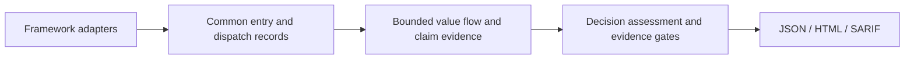

# Zazzles

Zazzles is a static application security testing (SAST) tool under active development.
It analyzes JavaScript, TypeScript and Python source to help developers and coding agents understand
how request inputs reach security-sensitive operations,
what validation and protection already hold, and where code needs hardening. Reports should give
reviewers source evidence and explicit analysis gaps so they can judge each finding.

The approach combines Tree-sitter source extraction, code-flow analysis and decision-model
assessment of source-backed evidence. Decision-model assessment is core to Zazzles' security judgment:
the code trace supplies the relevant inputs, operations and controls for the model to assess. We
develop and test with the OpenAI Luna Decision API (`gpt-6-luna`); support for Jev and other decision
models is planned.

Field validation and sink protection are separate questions: a valid email address does not establish
that a SQL query uses bound parameters. Missing source facts and unresolved behavior remain explicit
rather than becoming a safety claim or a vulnerability by assumption.

## Architecture and approach

Zazzles starts from an exposed operation and follows supported input values to a sensitive use.
The common entry and dispatch model separates **what is exposed**, **where it is registered**,
**which callable may run**, and **the inputs and controls of that particular invocation**.
Framework adapters supply these facts; bounded flow analysis builds claim evidence; decision-model
assessment and Go evidence gates determine the result. JSON, HTML and SARIF share that interpretation.



This lets one handler serve several operations without mixing their input or protection facts.
For example, exposing the same function through guarded and unguarded registrations must produce
separate contexts; protection on one cannot protect the other. Unknown dispatch alternatives and
zero-use entries remain visible as coverage gaps. A call relationship alone does not establish
that a request value reaches a sink, and a protected claim never certifies an entire entry.

The benefit is a reusable analysis/reporting contract across entry types, precise evidence for
remediation, and explicit limits as framework coverage expands. The building blocks are established
SAST techniques: [CodeQL](https://codeql.github.com/docs/writing-codeql-queries/about-data-flow-analysis/)
models data flow, [Joern](https://docs.joern.io/code-property-graph/) uses shared program representations,
and [Semgrep](https://docs.semgrep.dev/writing-rules/data-flow/taint-mode/overview) models sources,
sinks and sanitization. Zazzles's particular combination is its design, not a claim to have invented
those techniques or proven better accuracy. See the [technical approach](docs/technical-approach.md)
for rationale, comparisons and evaluation limits.

### Entry use cases and delivery status

| Entry/use case | What analysis starts from | Supported now | Planned extension |
|---|---|---|---|
| **HTTP** | A method/path registration and its handler context | Bounded Express JS/TS and Flask/Blueprint, RESTX and FastAPI Python routes; request fields into supported SQL/NoSQL, HTML, logging and outbound operations, with per-language limits | Broader dispatch and flow coverage; retain existing route filters/checks and evidence |
| **Browser** | A supported script, component or inline-script context | DOM/location/storage sources and supported DOM/framework rendering sinks; React, Vue, Angular, jQuery and bounded server-to-browser links | Explicit DOM/window `click`, `input`, `change`, `submit` and `message` registrations, callback contexts and event-value provenance (D4) |
| **Dynamic HTTP routes** | Source-generated registrations and factory-returned handlers | Selected returned-handler and Finale persistence patterns; generalized generation remains incomplete | Finite tables/loops, literal factory arguments and closure bindings; generated Flask/FastAPI routes and source-to-sink findings in VulnPy (D5) |
| **GraphQL resolvers** | A schema field bound to a resolver | Typed entry records, selectors and presenters are ready; resolver discovery/flow is pending | Bounded Node.js Apollo resolver maps and literal SDL; distinct argument/parent/context roles and field-specific findings (D6) |
| **gRPC methods** | A service/method registration bound to a handler | Typed entry records, selectors and presenters are ready; service discovery/flow is pending | Bounded Node.js grpc-js unary handlers with local proto3 declarations; request/metadata/callback roles; unsupported streaming stays explicit (D7) |

The shared model, migration of existing HTTP/browser consumers, and entry-specific reports/selectors
are implemented on this development branch. D4 is next; new adapter support is delivered and verified
separately. A recognized entry kind or accepted selector does not by itself establish discovery,
value flow or vulnerability coverage. The [milestone contracts](.zazz/specifications/common-entry-dispatch.md)
record the delivery order and acceptance checks.

## Explore sample findings

These saved reports show scans of intentionally vulnerable applications, including route and browser
entries, source-to-sink evidence, per-path protection, recorded assessments where available, and
Findings, Review and Protected results. Open one in your browser:

| Application | What the current sample shows | Output |
|---|---|---|
| **OWASP Juice Shop** | 152 route entries and 9 browser entries; DOM search and cross-tier track-order XSS, SQL/NoSQL query-construction findings, and a credential written to access logs | [View in browser](https://zazzcode.github.io/zazzles/docs/samples/juice-shop/findings.html) · [HTML file](docs/samples/juice-shop/findings.html) · [JSON](docs/samples/juice-shop/findings.json) · [SARIF](docs/samples/juice-shop/findings.sarif) |
| **Node.js Goof** | 19 route entries; reflected login XSS, stored Markdown XSS with separate create/update write paths, and two escaped outputs marked Protected | [View in browser](https://zazzcode.github.io/zazzles/docs/samples/nodejs-goof/findings.html) · [HTML file](docs/samples/nodejs-goof/findings.html) · [JSON](docs/samples/nodejs-goof/findings.json) · [SARIF](docs/samples/nodejs-goof/findings.sarif) |
| **Vulnerable TypeScript app** | 19 route entries; a reflected-XSS search response, plus Review records for a password logged in SQL text and other incomplete analysis | [View in browser](https://zazzcode.github.io/zazzles/docs/samples/vulnerable-typescript-app/findings.html) · [HTML file](docs/samples/vulnerable-typescript-app/findings.html) · [JSON](docs/samples/vulnerable-typescript-app/findings.json) · [SARIF](docs/samples/vulnerable-typescript-app/findings.sarif) |

**View in browser** opens the hosted copy published by GitHub Pages ([all samples](https://zazzcode.github.io/zazzles/docs/samples/)). GitHub's
file view shows HTML source rather than running it, so you can also download an HTML file and open
it locally. Findings appear first; expand rows for evidence and remediation, or click a category pill for its
glossary. No setup or model calls are needed. These [evolving samples](docs/samples/README.md) include
coverage limits and refresh instructions; they will be updated as Zazzles improves.

## Goals and current scope

The goal is to report vulnerabilities, weak security practices, and sufficient protection by entry and scoped claim,
with useful explanations and remediation guidance. Bearer and Semgrep Community Edition serve as local
comparison tools on source-reviewed cases.

Today, Zazzles analyzes local **JavaScript, TypeScript and Python** source:

- **JavaScript/TypeScript routes:** Express-style registrations, including CommonJS exports and static router mounts.
- **Python routes:** Flask/Blueprint, RESTX and FastAPI registrations.
- **Browser entries:** supported client-side entry points.
- **Flow analysis:** bounded tracing through handlers, imports, helpers, branches, selected asynchronous paths, and supported template/rendering operations.
- **Reports:** source evidence and claim judgments in JSON, standalone HTML and SARIF.

The [Python coverage guide](docs/python-support.md) records framework and flow limits.

Current capabilities:

| Area | Current support |
|---|---|
| **Cross-site scripting (XSS)** | Reflected server output (Express `send`/`write`/`end`, EJS, Handlebars, Pug); template construction before compilation; stored XSS through Mongoose/Sequelize model fields, with each write path kept separate; DOM sinks, jQuery, React, Vue and Angular templates, including trust bypasses; cross-tier links from a browser output to the server route and JSON response field that produce it. Protection is context-specific (HTML text, attribute, URL, script, style) and must hold on every modeled path. |
| **Injection** | Verified SQL construction/binding and operation models, including Sequelize and bounded Python DB-API support; JS/TS NoSQL selectors and `$where` construction. Python NoSQL remains pending. |
| **Input validation** | Source-backed field requirements and enforcing guards, kept separate from destination protection; missing business policy remains Review |
| **Logging** | Request data and credentials reaching verified loggers |
| **Outbound requests** | Request-influenced `fetch`/`axios` destinations |
| **Core decision assessment** | Versioned evidence and claim-specific questions, developed and tested with Luna; answers never replace missing source facts or override blocking gaps |

See the [XSS analysis guide](docs/analysis/xss.md) for the exact contracts and limits.

Full control-flow and whole-program interprocedural analysis, independent findings review, Go
analysis, and dependency vulnerability scanning remain planned. Recognizing a file extension in the file list
does not establish analysis support. A clean scan does not certify that an application is secure.

## Roadmap: vulnerability types

Checked boxes mark **initial implementation**, not complete coverage of every framework or input
path. Each capability uses source-reviewed answer keys and vulnerable/protected/unknown controls;
remaining gaps stay visible. The [project plan](.zazz/project/implementation-plan.md#future-capability-branches)
contains the detailed per-language checklist and delivery order.

**Initial implementation**

- [x] Input validation — source-backed field policies and enforcement, separate from sink protection.
- [x] SQL injection — verified query construction, value binding and source-to-operation evidence.
- [x] NoSQL injection for JavaScript/TypeScript — supported selectors and executable expressions.
- [x] Sensitive-data logger leaks — actual credential/personal-data content and logging behavior.
- [x] Reflected/server-output XSS — HTML responses and supported template output contexts.
- [x] Stored XSS — bounded source/write/read/render traces with explicit origin gaps.
- [x] Client-side/DOM/framework XSS — supported JS/TS browser patterns and inline scripts in Python templates.
- [x] API-to-browser XSS linkage for JavaScript/TypeScript — bounded cross-tier evidence.
- [x] Python support — Flask/Blueprint, RESTX, FastAPI, DB-API bindings, Jinja/HTML, logging and outbound evidence.

**Next and planned work**

- [ ] **Common entry and dispatch model — in progress:** shared records, existing HTTP/browser migration and typed reports/selectors implemented; explicit browser events, broader dynamic HTTP, GraphQL and gRPC adapters follow.
- [ ] Command injection — process/shell execution and protective patterns across JavaScript, TypeScript and Python.
- [ ] XSS hardening — renderer configuration, helpers, generated routes, stored/cross-tier origins and VulnPy coverage gaps.
- [ ] Path traversal — request-influenced paths and enforced containment.
- [ ] Code injection — request-to-eval/code-generation paths.
- [ ] XML external entities (XXE) — actual parsers and their security configuration.
- [ ] Open redirect — request-influenced destinations and enforcing policy.
- [ ] Weak randomness — random values used for security-sensitive purposes.
- [ ] Cookie, session and security headers — configuration and source-backed baseline requirements.
- [ ] Server-side request forgery (SSRF) — assess existing outbound-destination candidates and restrictions.
- [ ] Prototype pollution — JS/TS prototype/object operations; document Python non-applicability.
- [ ] Complete Python NoSQL and API-to-browser XSS linkage coverage.
- [ ] Dependency vulnerability scanning (SCA) — resolved JavaScript/TypeScript and Python packages and advisories.
- [ ] Secret scanning — private material in source, with public keys and placeholders as controls.

All future functionality must include JavaScript, TypeScript and Python acceptance evidence, with
semantic non-applicability documented where relevant. We continue expanding the vulnerable-app
library and comparing scans with independent source expectations and pinned Semgrep CE/Bearer
baselines. VulnPy's known SQL/XSS misses remain tracked coverage work.

## Agent-first philosophy

Our goal is to help agents fix code correctly. Report established vulnerabilities **and poor
practice worth remediating or refactoring**, even when an exploit has not been demonstrated.
Preserve sufficient protection, explain uncertainty honestly, and provide evidence and targeted
remediation. Validation and destination-specific protection can be separate improvements at the
same operation. Read the [project philosophy](docs/philosophy.md).

## Documentation

Start with the [documentation index and introduction](docs/README.md):

- [Technical approach](docs/technical-approach.md) — architecture rationale, strengths and comparisons
- [Philosophy](docs/philosophy.md) — why and when an agent should fix code
- [Getting started](docs/getting-started.md) — prerequisites, compilation, and `.env`
- [Running scans](docs/running-scans.md) — modes, entry selection, output folders, and exports
- [Interpreting results](docs/interpreting-results.md) — Findings, Review, Protected, evidence, and remediation
- [Finding categories](docs/glossary.md) — definitions and current coverage
- [Decision-model setup](docs/decision-models.md) — core assessment, source transmission and provider credentials
- [CI/CD](docs/ci.md) — JSON, HTML, and SARIF artifacts
- [Contributing](docs/contributing.md) — development workflow and verification

## Setup

Install the Go toolchain declared in `go.mod` and a C compiler for the Tree-sitter cgo bindings.
Build from the checkout root:

```bash
go build -o bin/scan ./cmd/scan
```

For a new local setup, copy [.env.sample](.env.sample) to `.env`; merge settings if `.env` already
exists so you preserve your keys. Zazzles does not auto-load `.env`. Model-assessed security scans require the configured API key.
See the [setup guide](docs/getting-started.md) for full instructions.

### Required decision-model setup

Configure [required decision-model assessment](docs/decision-models.md) with Luna before running a
security assessment. Decision-model judgment is required and core to the workflow. The scanner
reads the selected provider's key from its process environment. Model requests transmit source
evidence and need an explicit request cap; a key is not a reason to run paid assessment automatically.

Pass `--judge openai --judge-model gpt-6-luna --judge-limit <count>` to select the required model
assessment. Inventory, evidence inspection and saved-report rendering remain available without API
calls. Commands without `--judge` collect evidence but do not complete a model-assessed security scan.

## Run

```bash
export SCAN_FINDINGS_DIR="$HOME/Dev/zazzcode/zazzles/_test-findings"
./bin/scan --analyze --entry server.ts \
  --judge openai --judge-model gpt-6-luna --judge-limit 10 /path/to/juice-shop
./bin/scan --analyze --entry src/server.ts \
  --judge openai --judge-model gpt-6-luna --judge-limit 10 /path/to/vulnerable-typescript-app
./bin/scan --analyze --entry server/routes.py \
  --judge openai --judge-model gpt-6-luna --judge-limit 10 /path/to/ThreatByte
```

The request cap bounds the run; uses beyond it remain unassessed and the report is incomplete.
Choose a limit appropriate to the authorized scope. Each run creates `<output-root>/<repo-name>/run-<id>/` containing `findings.json`, `findings.html`, and
`findings.sarif`. Open the printed HTML path to review expandable source rows and category definitions.
`--output-dir` overrides the environment variable; `--output-dir ""` disables bundle output.

You can regenerate views without rescanning or calling a model:

```bash
./bin/scan --export-html /path/to/run/findings.json > /path/to/run/findings.html
./bin/scan --export-sarif /path/to/run/findings.json > /path/to/run/findings.sarif
```

The [running guide](docs/running-scans.md) covers inventory modes, route/check selection, output
formats, and limitations. JSON retains evidence for agents, HTML supports human review, and SARIF
provides standard security-tool interchange. Keep source-containing reports outside Git by default.

## Interpret results

| Column | Meaning | Action |
|---|---|---|
| **Findings** | Established problems, including poor practice that merits correction without a demonstrated exploit | Remediate or refactor the named problem and verify the change |
| **Review** | Evidence does not yet establish a problem or adequate protection | Resolve the named uncertainty before deciding on a fix |
| **Protected** | Evidence supports protection for the named claim | Preserve it; assess other fields and uses independently |

**Poor practice** is a finding to fix, not a request to wait for an exploit. The current deterministic
rules report string-built SQL and executable NoSQL `$where` constructions as poor practice.
A missing modeled validator or document constraint alone remains Review. A model's potential
vulnerability answer is retained for investigation; it does not automatically establish a finding.

**Categories** are overlapping labels, not additional findings. Route location identifies a route's
declaration; Finding location identifies the operation in the expanded record. The current report
still groups several concerns within a use record; distinct claim-level counting is planned. Read the
[results guide](docs/interpreting-results.md) for statuses, counts, and remediation examples.

Exit `0` means the operation completed, not that the target is safe. Exit `1` signals execution or
requested-assessment failure; exit `2` signals invalid usage. A finding-severity CI gate is not yet
implemented.

## Contributing

Developing Zazzles: use the [contributor guide](docs/contributing.md), [AGENTS.md](AGENTS.md), and
[developer agent orientation](.zazz/docs/zazzles-agent-orientation.md) for workspace conventions, branches,
commands, and the internal documentation map. Run relevant scoped checks;
CI verifies formatting, vet, build, and race tests. Work stays on feature branches, draft PRs target
`stage`, and humans review and merge. Live model calls are separate from offline tests.

Internal engineering material lives under `.zazz/`: [architecture](.zazz/architecture.md),
[implementation plan](.zazz/project/implementation-plan.md), [contracts](.zazz/specifications/README.md),
and the [engineering documentation map](.zazz/docs/zazzles-agent-orientation.md#documentation-map).

Analysis contributors: read the [Zazzles analysis rules and guidelines](docs/analysis/README.md) for
SQL/NoSQL and XSS judgment, input-validation policy, and calibration controls. Comparison runs use the
[Bearer runbook](docs/samples/nodejs-goof/bearer-runbook.md) and the
[Semgrep CE cheat sheet](docs/semgrep-ce-cheat-sheet.md).
